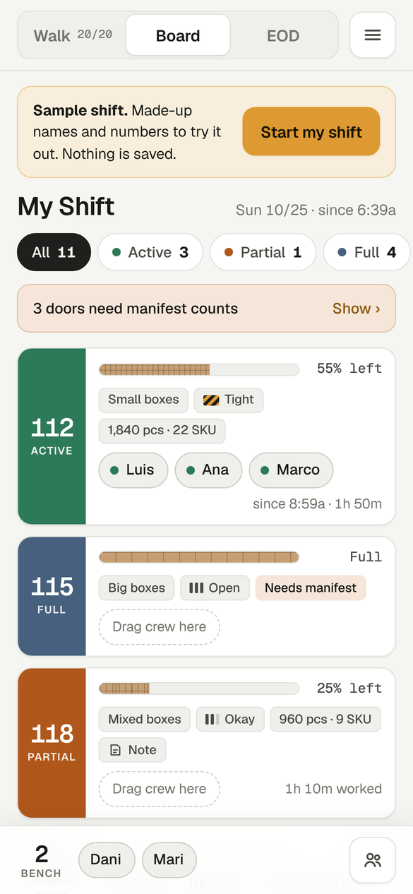
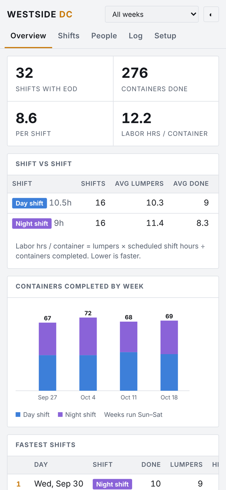
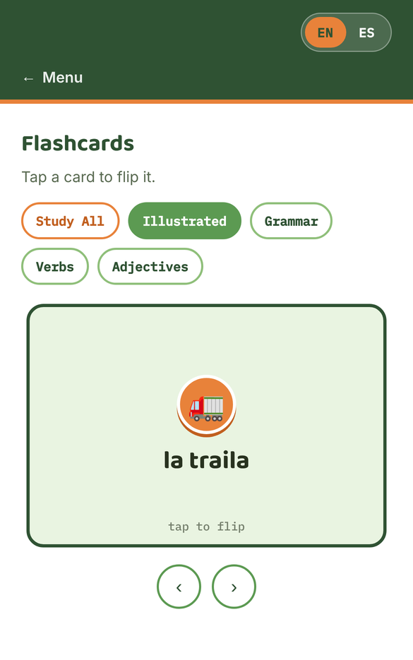

# Hi, I'm Jessie 👋

I solve problems by figuring out how the whole thing works first. Whether it's a dock full of trailers, a customer's dead phone, or a small shop's order book, I look for where the process breaks down, then I fix that spot or build a tool that does.

I've led a warehouse crew, done technical support, and run a small business. The job titles changed, but the work was the same every time: understand the system, find the weak point, make it better.

## How I work

- **Start with the real problem.** A wrong count or a slow shift is usually a symptom. I trace it back to where the information got lost or the handoff failed.
- **See the whole flow.** A dock is a system: doors, trailers, people, paperwork and time all push on each other. Changing one piece changes the rest, so I map it before I touch it.
- **Build the smallest thing that works.** My apps start as one screen that fixes one headache. I use them on real shifts and add only what the work asks for.
- **Make it easy for the next person.** A fix that only I understand isn't finished. I write the steps down and train people on them.

## Problems I've solved

| | The problem | What I built |
|---|---|---|
|  | Nobody could see who was on which door or how far along each trailer was without walking the floor. | **Floor Tracker** · private. Runs an unloading shift from a phone, with crew assignments, trailer progress and a time-stamped log. Features from it were picked up for the company's own dashboard. |
|  | The start-of-shift dock walk lived on paper, and the end-of-shift report had to be typed from memory. | **Dock Walk** · private. Tap each door's status as you walk, run the crew from one board, and the report builds itself. |
|  | Box and pallet counts were kept in people's heads and didn't always match the manifest. | **Lumper Pallet Tracker** · private. Counts by SKU as you unload with a live total. My first app, and coworkers started using it on their own. |
|  | Shift reports sat buried in a group chat where nobody could compare one day to the next. | **Shift Board** · private. Turns end-of-day reports into rankings and charts. Data stays on your phone. |
|  | Half my crew spoke Spanish and I didn't. | **Warehouse Spanish** · private. Flashcards and real work phrases for the floor, in English or Spanish. |
|  | Budget apps think in months, but bills come due between paychecks. | **[Payday Planner](https://github.com/bjessief-apps/Payday-Planner)** · [open app](https://bjessief-apps.github.io/Payday-Planner/). Matches each paycheck to the bills it covers and shows what's safe to spend. |
| | Saving a long playlist one track at a time. | **[Playedlist](https://github.com/bjessief-apps/Playedlist)**. A Python terminal app that downloads a whole YouTube playlist as audio and keeps it organized. |

Not every fix was an app. I wrote a new-hire training plan and proposed filling open spots with inside transfers, and my company put both into use.

## Where I've worked

- **Warehouse Lead.** Ran the container unload doors for my shift, kept the crew on standard, and trained more than 30 new hires.
- **Warehouse Worker.** Unloaded and staged freight, checked product against manifests, and flagged what didn't match.
- **Wireless Sales Representative.** Sold plans and devices, and became the person customers came back to when their phone wasn't working.
- **Shop Manager, custom apparel.** Ran the day-to-day: brought in clients, designed logos, took orders, tracked due dates and inventory.
- **Technical Support Representative, satellite TV.** Tier 1 and Tier 2 support by phone. Diagnosed hardware, signal and software problems and walked customers through the fix.

## What I work with

- **Building apps:** HTML, CSS, JavaScript, Python, VS Code, Git and GitHub Pages
- **Computers:** Windows 11, Linux (Ubuntu, Kali, MX Linux, dual-boot and GRUB), the terminal
- **Hardware:** diagnostics and repair, multimeter testing
- **People:** leading a crew, training new hires, writing down how things should run

## What I'm doing now

- Working through the Google IT Support Professional Certificate on Coursera
- Getting better at writing my own code, not just reading it
- Looking for my next role, somewhere I can use my head, keep leading people, and keep building

## Get in touch

📧 1jessiefrazier@gmail.com
