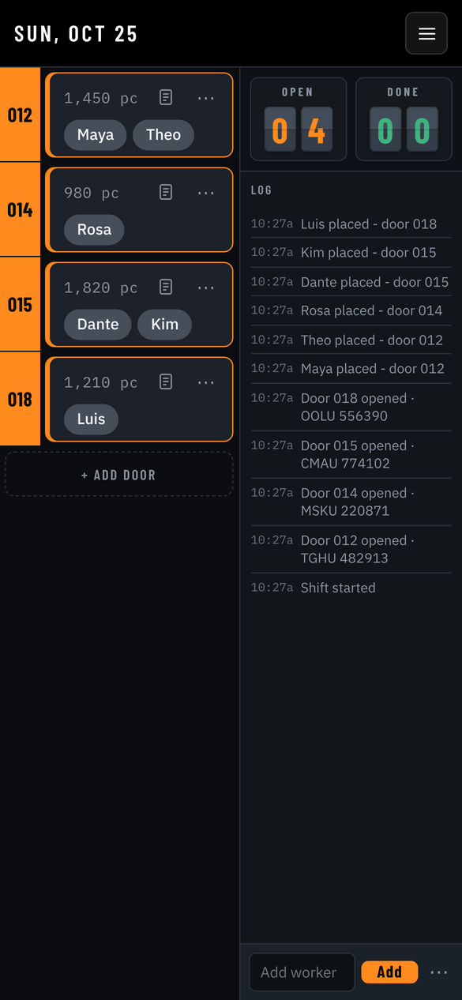
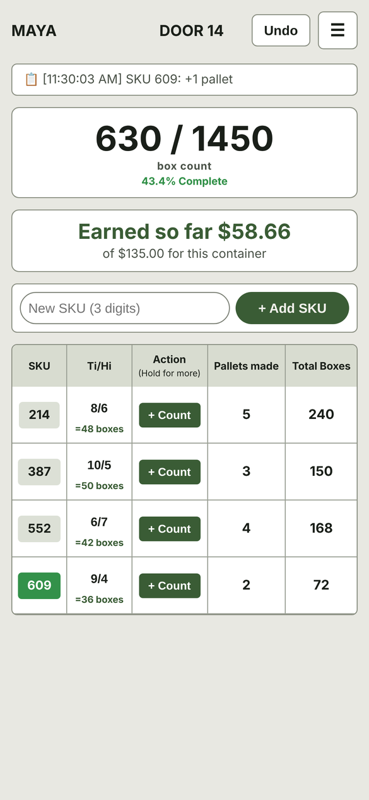

# Hi, I'm Jessie 👋

I like figuring out how things work and making them run smoother. I've led a warehouse crew, done technical support, and managed a small shop, and I build small tools for problems I run into along the way.

## Projects

| | Project | What it does |
|---|---|---|
|  | **Floor Tracker** · private | A phone app for running an unloading shift: crew assignments, trailer progress, and a time-stamped log. |
|  | **Lumper Pallet Tracker** · private | Counts pallets and boxes by SKU during an unload and keeps a running total. My first app. |
| | **[Playedlist](https://github.com/bjessief-apps/Playedlist)** | A Python terminal app that downloads a YouTube playlist as audio and keeps it organized. |

## Experience

- **Warehouse Lead:** ran the unload doors, trained new hires, wrote a training plan
- **Warehouse Worker:** unloaded and staged freight, checked product against manifests
- **Wireless Sales Representative:** sales, device setup, phone troubleshooting
- **Shop Manager, custom apparel:** clients, logo design, orders, inventory
- **Technical Support Representative:** phone support for hardware, signal and software issues

## What I work with

- **Apps:** HTML, CSS, JavaScript, Python, VS Code, Git
- **Computers:** Windows 11, Linux (Ubuntu, Kali, MX Linux), the terminal
- **Hardware:** diagnostics and repair

## Right now

- Working through the Google IT Support Professional Certificate
- Getting better at writing my own code
- Looking for my next role

## Get in touch

📧 1jessiefrazier@gmail.com
